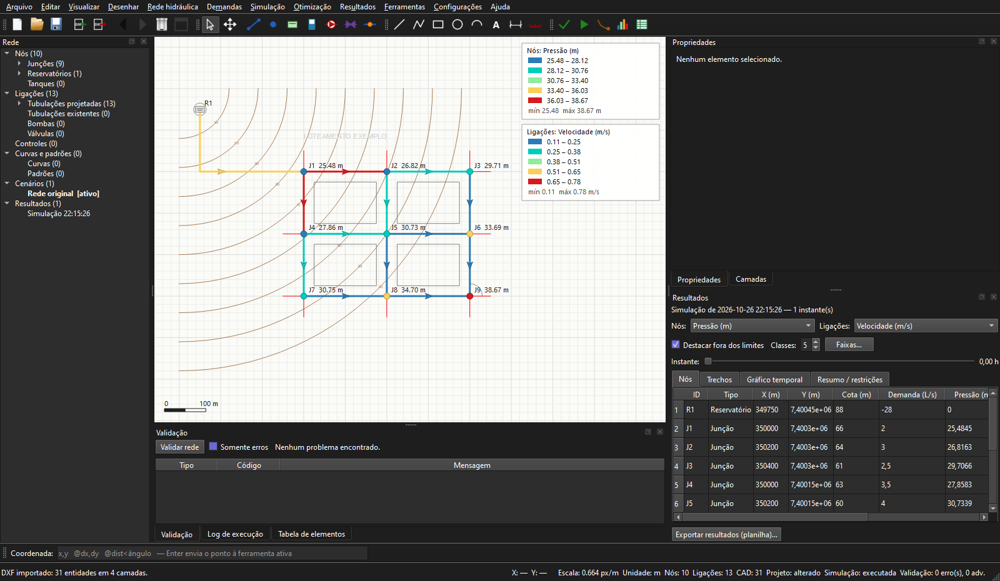
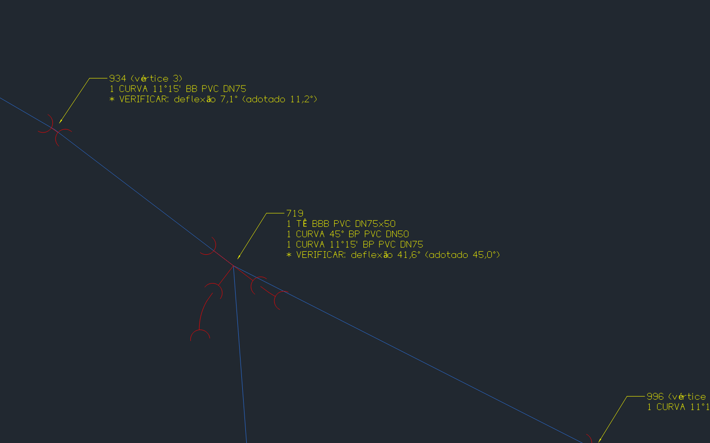

<p align="center">
  
</p>

<h1 align="center">HidroPy</h1>

<p align="center"><b>Simulador hidráulico baseado em Python</b><br>
Desenho, simulação e otimização de redes de distribuição de água num único programa.<br>
Gratuito, de código aberto e pronto para ser usado também por agentes de IA.</p>

## Apoie o projeto

O HidroPy é gratuito e de código aberto. Se ele faz parte do seu trabalho, especialmente em
projetos comerciais, considere fazer uma doação via Pix: ela ajuda a manter o projeto e a
desenvolver novas funcionalidades. Qualquer valor é bem-vindo!

<p align="center">
  
</p>



## Sobre

O HidroPy é um programa desktop para projetar redes de abastecimento de água. Ele reúne um
ambiente de desenho no estilo CAD, a simulação hidráulica com o motor **EPANET** e a
**otimização econômica dos diâmetros** por algoritmo genético. A rede pode ser desenhada sobre
uma base topográfica em DXF, com coordenadas reais, e os resultados saem em mapas, planilhas,
relatórios e plantas DXF prontas para o projeto executivo.

## Funcionalidades

**Desenho e edição**
- Ambiente CAD com zoom, pan, snap (nós, extremidades, pontos médios, centros, interseções e
  grade), entrada de coordenadas absolutas, relativas e polares, camadas e desfazer/refazer.
- Linha, polilinha, retângulo, círculo, arco, texto, cota e medição; mover, rotacionar,
  espelhar, copiar e colar.
- Importação de DXF com escolha das camadas e camadas de referência bloqueadas.

**Rede hidráulica**
- Junções, reservatórios, tanques, tubulações com vértices, bombas e válvulas
  (PRV, PSV, PBV, FCV, TCV e GPV); curvas, padrões temporais e controles.
- Conversão de linhas do DXF em tubulações, divisão de tubulações e união de nós arrastando
  um sobre o outro.
- Trechos existentes (executados), que a otimização preserva.
- Importação e exportação de arquivos EPANET (`.inp`).
- Validação da rede antes dos cálculos, com erros e advertências.

**Demandas**
- Projeção populacional pelos métodos aritmético e geométrico, com tabela e gráfico.
- Consumos nodais pelo método linear (vazão por metro de rede), com coeficientes K1 e K2 e
  resumo antes de aplicar.

**Simulação e otimização**
- Simulação EPANET em regime permanente ou período estendido, executada em segundo plano.
- Mapas temáticos de pressão, carga, demanda, vazão, velocidade, perda de carga e estado;
  setas de escoamento, destaque de valores fora dos limites e gráficos ao longo do tempo.
- Otimização de diâmetros por algoritmo genético, com catálogo de diâmetros e custos,
  limites de pressão e velocidade e comparação trecho a trecho com a rede original.
- Cenários para comparar alternativas sem perder a rede original.

**Saídas**
- Planilhas Excel/CSV com os resultados de nós e trechos.
- Relatórios em PDF ou HTML.
- **Planta de cálculo** em DXF, com as informações escolhidas para trechos e nós.
- **Planta de execução** em DXF, com as peças de conexão de cada junção e vértice (tês,
  cruzetas, curvas, reduções e CAPs, bolsa/ponta), chamadas em multileader e quadro de
  quantidades.
- Linha de comando com saída JSON, para automação e para agentes de IA.



## Instalação

### Executável para Windows

Baixe a versão mais recente na página de *Releases* do repositório, descompacte a pasta
`HidroPy` e execute `HidroPy.exe`. Não é preciso instalar Python nem outras dependências.

### A partir do código-fonte

Requer Python 3.10 ou mais recente (desenvolvido com Python 3.14).

```bash
python -m pip install -r requirements.txt
```

```bash
python main.py
```

Também é possível abrir um arquivo diretamente: `python main.py examples/rede_exemplo.shcad`
(aceita `.shcad`, `.dxf` e `.inp`).

## Primeiros passos

1. Abra `examples/rede_exemplo.shcad` ou importe uma rede `.inp` (menu **Arquivo**).
2. Valide a rede (**F4**) e execute a simulação (**F5**).
3. Explore os mapas e as tabelas no painel **Resultados**.
4. Execute a otimização de diâmetros (**F6**) e compare as soluções.
5. Exporte a planilha de resultados (**Ctrl+E**), o relatório e as plantas DXF.

O manual completo está no próprio programa, em **Ajuda → Manual do HidroPy** (**F1**).

## Linha de comando

As operações principais também rodam sem abrir a janela:

```bash
HidroPy.exe cli simular projeto.shcad --json
```

Comandos disponíveis: `info`, `validar`, `simular`, `otimizar`, `comparar`,
`aplicar-otimizacao`, `ativar-cenario`, `exportar-dxf`, `planilha`, `relatorio` e
`importar`. A referência completa, com o formato da saída JSON, está em
[docs/CLI.md](docs/CLI.md).

## Uso com agentes de IA

O HidroPy pode ser operado por agentes de IA, como o Claude Code, por meio da linha de
comando. A pasta [`skill/hidropy`](skill/hidropy/SKILL.md) traz uma *skill* que ensina o agente
a validar, simular, otimizar e comparar cenários: basta pedir, por exemplo, *"simule a rede e
otimize os diâmetros para o melhor cenário"*. O agente roda as otimizações, grava as
alternativas como cenários no projeto e apresenta um resumo para você decidir.

Para instalar no Claude Code, copie a pasta `skill/hidropy` para `~/.claude/skills/`
(no Windows, `%USERPROFILE%\.claude\skills\`).

## Gerar o executável

```bash
python -m pip install pyinstaller
```

```bash
python -m PyInstaller --noconfirm HidroPy.spec
```

O resultado fica em `dist/HidroPy/`. Para distribuir, compacte essa pasta inteira.

## Estrutura do projeto

```
main.py            ponto de entrada (interface, linha de comando e processos de cálculo)
main4.py           otimizador de diâmetros (algoritmo genético)
HidroPy.spec       configuração do executável (PyInstaller)
src/
  hydraulics/      modelo da rede, projeto, validação, demandas e projeção populacional
  integration/     simulação e otimização em segundo plano, importação/exportação .inp
  cad/             área de desenho, ferramentas, snap, DXF e peças de conexão
  results/         mapas temáticos, tabelas e relatórios
  ui/              janela principal, painéis e diálogos
  cli.py           linha de comando
  resources/       ícone, splash e manual
tests/             testes automatizados (pytest)
examples/          redes e desenho de exemplo
docs/              documentação complementar
skill/hidropy/     skill para agentes de IA (Claude Code)
```

## Testes

```bash
python -m pytest -q
```

## Tecnologias

[PySide6](https://doc.qt.io/qtforpython/) (interface), [EPANET](https://www.epa.gov/water-research/epanet)
por meio do [WNTR](https://github.com/USEPA/WNTR) (simulação hidráulica),
[DEAP](https://github.com/DEAP/deap) (algoritmo genético), [ezdxf](https://ezdxf.mozman.at/)
(DXF), pandas, matplotlib e openpyxl.

## Licença

Distribuído sob a licença MIT. Veja o arquivo [LICENSE](LICENSE).

## Autor

**Caio Henrique de Oliveira Nascimento**<br>
Estudante de Engenharia Ambiental e Sanitária — IFCE, campus Maracanaú<br>
[LinkedIn](https://www.linkedin.com/in/caio-henrique-6a6650236)
